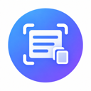
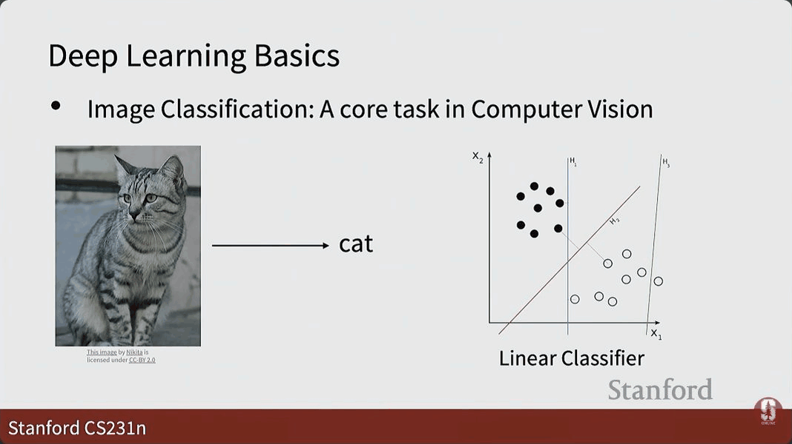

  
  <h1>SelectSight</h1>
  
<strong>Copy text directly from images, paused videos, and screenshots — locally in your browser.</strong>

  

    <a href="https://chromewebstore.google.com/detail/selectsight/acpnlpaaaihjngcanakmkiabdeaepooc">Chrome Web Store</a> ·
    <a href="https://selectsight.lol/">Website</a> ·
    <a href="https://selectsight.lol/how-to-use">Interactive Guide</a> ·
    <a href="./README.zh-CN.md">简体中文</a>
  

---

  

**SelectSight** is a Chrome extension and suite of browser tools that makes text inside images and paused video frames selectable just like ordinary webpage text. Basic optical character recognition (OCR) runs **100% locally on your device** — no account required and no image uploads.

---

## Key Features

- **Hover, Drag, Release to Copy** — Move your cursor over a webpage image or paused video frame, drag across the words you need, and release to copy straight to your clipboard.
- **Screenshot Region Capture** — For charts, slides, Canvas elements, or areas you cannot directly hover, press `Option + S` (macOS) or `Alt + S` (Windows) to frame any visible region and extract its text locally.
- **100% Local OCR by Default** — Text recognition runs in your browser using local WebAssembly models across 20 languages. Your images stay on your device.
- **Free In-Place Translation** — Translate selected words or captured text online at no credit cost (up to 400 characters per request without signing in, or up to 2,000 characters after signing in).
- **Editable Document Exports** — Save plain text (`.txt`) for free, or reconstruct editable **Word (`.docx`)** and **Excel (`.xlsx`)** files with optional cloud structuring (5 one-time free credits granted upon first verified sign-in; 1 credit per new export).

---

## Browser Image Tools (No Installation Needed)

Already have an image file or screenshot? Use our browser-based tools directly at **[selectsight.lol](https://selectsight.lol/)**:

| Tool | What it does | Privacy & Allowance |
| :--- | :--- | :--- |
| **[Image to Text](https://selectsight.lol/image-to-text)** | Extract and edit plain text from JPG, PNG, WebP, or BMP files. | **100% on-device** · Free, no sign-up, no uploads |
| **[Image to Excel](https://selectsight.lol/image-to-excel)** | Convert table screenshots, invoices, and receipts into editable `.xlsx` cells with real numeric values. | Images stay on device; recognized text & coordinates sent for AI structuring · **3 free/day** |
| **[Image to Word](https://selectsight.lol/image-to-word)** | Reconstruct lecture slides, handouts, and photographed pages into editable `.docx` headings, paragraphs, and tables. | Images stay on device; recognized text & coordinates sent for AI structuring · **3 free/day** |
| **[Translate Image](https://selectsight.lol/translate-image)** | Translate text directly in place on your image and download a full-resolution PNG. | Local OCR & image composition; only text is sent for translation · **3 free/day** |

---

## Privacy Architecture

SelectSight is built around **local-first processing**:

1. **Extension Hover & Screenshot OCR**: Runs entirely on your device. Merely browsing, hovering over images, or copying recognized text never uploads page images to any server.
2. **Browser Tools**: Source images never leave your device. [Image to Text](https://selectsight.lol/image-to-text) sends neither images nor text externally; Excel, Word, and Translate Image run OCR locally and send only recognized text (and layout coordinates for Word/Excel) for structuring or translation.
3. **Explicit Cloud Exports**: Only when you explicitly trigger a Word or Excel export inside the extension and confirm the prompt does the selected region upload for cloud document reconstruction.

Read the full details in our [Privacy Policy](https://selectsight.lol/privacy) and [Third-party Licenses](https://selectsight.lol/licenses).

---

## Feedback & Support

This repository serves as the public documentation hub, [changelog](./CHANGELOG.md), and issue tracker for SelectSight.

- **Bug reports & feature requests**: Open an [Issue](../../issues) (please avoid attaching screenshots containing personal or sensitive data).
- **Usage guide & troubleshooting**: Visit [How to use](https://selectsight.lol/how-to-use) and [Support](https://selectsight.lol/support).
- **Account & billing inquiries**: Email `j.ohnie@outlook.com`.
