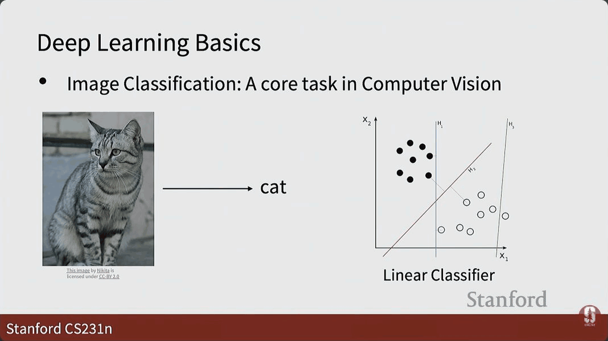

  
  <h1>SelectSight</h1>
  
<strong>直接拖选并复制网页图片、暂停视频与截图中的文字 —— 默认浏览器本地识别，图片不上传。</strong>

  

    <a href="https://chromewebstore.google.com/detail/selectsight/acpnlpaaaihjngcanakmkiabdeaepooc">Chrome 应用商店</a> ·
    <a href="https://selectsight.lol/?lang=zh">官方网站</a> ·
    <a href="https://selectsight.lol/how-to-use?lang=zh">交互式使用指南</a> ·
    <a href="./README.md">English</a>
  

---

  

**SelectSight** 是一款 Chrome 浏览器扩展及在线图片文字工具集，让你像选择普通网页文字一样，直接在图片和暂停视频画面上划词复制（类似微信/macOS 原生实况文本体验）。基础文字识别（OCR）**100% 在本机浏览器内运行**，无需注册账号，原图不上传服务器。

---

## 核心特性

- **悬停即选，松开复制** —— 鼠标移到网页图片或暂停的视频帧上，按住拖选需要的词句，松开即可自动复制到剪贴板。
- **快捷键框选截图** —— 遇到 Canvas 图表、幻灯片或无法直接悬停的区域，按 `Option + S`（macOS）或 `Alt + S`（Windows）框选可见区域，即可在本地提取文字。
- **默认纯本地 OCR（支持 20 种语言）** —— 基于 WebAssembly 在浏览器本地完成文字检测与识别，兼顾响应速度与数据隐私。
- **免费在线翻译** —— 划选图片文字后可一键翻译（未登录单次最多 400 字符，登录后最多 2,000 字符，不消耗积分），支持先修正识别原文再复制译文。
- **结构化文档导出** —— 纯文本（`.txt`）免费保存；支持导出可编辑的 **Word（`.docx`）** 与 **Excel（`.xlsx`）**（首次验证邮箱赠送 5 个一次性共享点数，每次新导出消耗 1 点）。

---

## 免安装在线图片工具

如果手头已有图片或截图文件，无需安装扩展即可直接在浏览器中使用：

| 在线工具 | 功能说明 | 隐私处理与免费额度 |
| :--- | :--- | :--- |
| **[图片转文字](https://selectsight.lol/zh/image-to-text)** | 提取 JPG、PNG、WebP、BMP 或剪贴板截图中的纯文本，可直接编辑复制。 | **100% 本机运行** · 完全免费、无需注册、零上传 |
| **[图片转 Excel](https://selectsight.lol/zh/image-to-excel)** | 将发票、小票、聊天报价表截图转为可编辑 `.xlsx`，数值单元格可直接参与 `SUM` 计算。 | 原图留在本机，仅发送识别文字与坐标供 AI 整理表格 · **未登录共享每日 3 次免费** |
| **[图片转 Word](https://selectsight.lol/zh/image-to-word)** | 将课程讲义、文章截图、合同照片重建为含标题、段落与真实表格的 `.docx` 文档。 | 原图留在本机，仅发送识别文字与坐标供 AI 整理排版 · **未登录共享每日 3 次免费** |
| **[翻译图片](https://selectsight.lol/zh/translate-image)** | 在原图对应位置直接排版替换为译文，支持原文/译文切换对比与原分辨率 PNG 下载。 | 本地完成 OCR 与图像合成，仅发送文字翻译 · **未登录共享每日 3 次免费** |

---

## 隐私与数据处理边界

SelectSight 坚持 **本地优先（Local by Default）** 原则：

1. **扩展日常划选与截图复制**：完全在你的设备本地完成，浏览网页、悬停识别与复制文字均不会上传页面图片。
2. **网页在线工具**：原始图片始终保留在你的浏览器内。[图片转文字](https://selectsight.lol/zh/image-to-text) 不向服务器发送任何图片或文字；Word、Excel 与翻译工具在本地完成识别后，仅发送识别出的文本（及排版坐标）用于整理或翻译。
3. **显式云端导出**：仅当你在扩展内主动选择导出 Word / Excel 并确认提示时，才会上传所选区域以完成文档结构重建。

完整说明请参阅 [隐私政策](https://selectsight.lol/privacy) 与 [第三方开源许可](https://selectsight.lol/licenses)。

---

## 问题反馈与联系

本仓库是 SelectSight 的公开文档主页、[版本更新日志](./CHANGELOG.md) 与问题反馈中心：

- **Bug 反馈与功能建议**：欢迎提交 [GitHub Issue](../../issues)（提交截图时请注意遮挡个人隐私信息）。
- **上手演示与常见问题**：查看 [使用指南](https://selectsight.lol/how-to-use?lang=zh) 与 [支持页面](https://selectsight.lol/support)。
- **账号与账单支持**：发送邮件至 `j.ohnie@outlook.com`。
